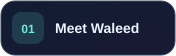
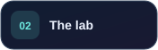
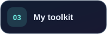
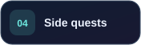
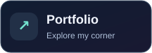
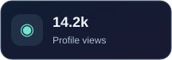
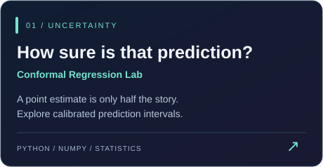
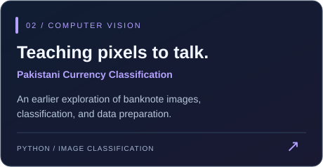
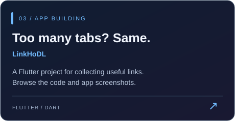
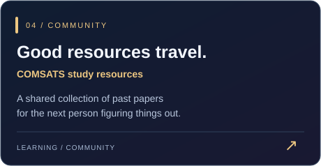

  

  
  
  
  
  

  
  
  
  

## About me

### Hello, World! 👋

I'm **Waleed**, currently pursuing a Master's in **Data Science**. I'm drawn to the questions behind the numbers: why a model works, where it gets confused, and whether a good result survives a second look. This is my corner for exploring those questions and building a few useful things along the way.

- 🧠 **Exploring:** machine learning, statistics, and regression.
- 🔍 **Curious about:** how much we should trust a model's predictions.
- 🧪 **On the workbench:** reproducible analysis and prediction intervals.
- 💚 **Beyond the models:** web projects and community learning resources.

 

## Project lab

  
  
  
  

<a href="https://github.com/waleedsid/personal-portfolio-website">🌐 Explore my earlier web work</a> &nbsp; · &nbsp; <a href="https://github.com/waleedsid?tab=repositories">Browse all repositories →</a>

## Toolbox

A mix of tools from my studies, web projects, and design work.

<h4>Programming languages</h4>

  
  
  
  
  
  

<h4>Web Technologies </h4>  
  

<h4>Frameworks</h4>  
  
  

<h4>Frontend Tools</h4>  
  
  

## Learning log

Courses, certifications, and milestones from my learning journey.

1. **User Experience & User Interface Designing | CyberVision International | Mar 2021**
2. **UI/UX Design With Figma | Udemy | Issued: Sept 2022**
3. **GOF Pattern Design | Udemy | Issued: Sept 2022**
4. **Content Marketing | HubSpot Academy | Issued: Dec 2023**
5. **Generative AI | Udemy | Issued: Jan 2024**
6. **Facial Recognition Using TensorFlow And Teachable Machine | Udemy | Issued: Jan 2024**
7. **Data Mesh - A Modern Decentralized Data Management Concept | Udemy | Issued: Sept 2024**
8. **3+ Certifications| Passed LinkedIn Skill Assessment**
9. **50+ Badges and 15+ Trophies from Microsoft**

## Let's connect

Have an interesting dataset, a tricky question, or an idea to build? Let's talk.

  <a href="https://www.linkedin.com/in/waleedsid/">LinkedIn</a> &nbsp; · &nbsp;
  <a href="https://medium.com/@waleedsid">Medium</a> &nbsp; · &nbsp;
  <a href="https://discord.gg/waleedsid">Discord</a> &nbsp; · &nbsp;
  <a href="https://waleedsid.netlify.app/">Website</a>

<strong>Keep asking questions. Keep building. 🚀</strong>

<a href="#about-me">↑ Back to the top</a>

